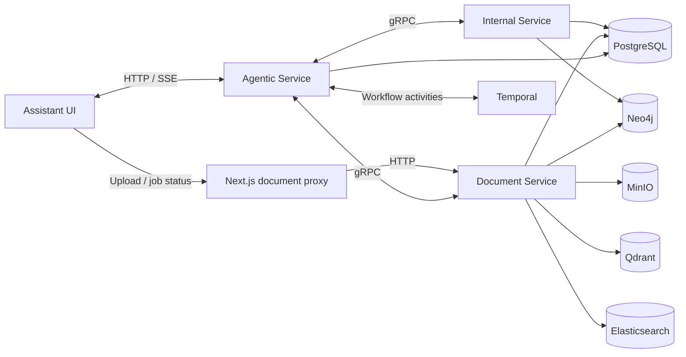
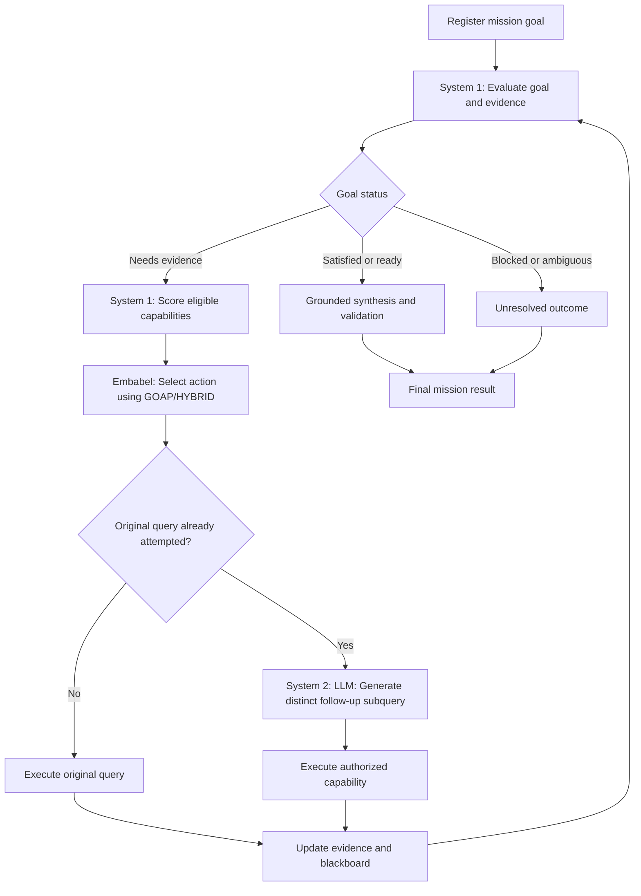

<p align="center">
  
</p>

<h1 align="center">Sparrow-X</h1>
<p align="center"><strong>Agent-Powered Company Intelligence</strong></p>

**SparrowX** is an internal knowledge and agentic investigation platform for engineering organizations. It combines structured company context, document intelligence, bounded semantic decisions, goal-directed execution and verifiable evidence in a single assistant.

>Think of the intelligence behind enterprise AI platforms like Glean and Moveworks. This is the perspective of one of the Agentic Engineers building and maintaining them.
 


## Capabilities

- **Internal knowledge discovery** — resolve service owners, engineers, teams, repositories, dependencies, architecture documents and runbooks.
- **Evidence-backed investigations** — connect incident reports, operating procedures and company relationships; identify supported findings and unresolved questions.
- **Operational analysis** — compare deployment practices, documented standards and incident history; produce grounded assessments and recommendations.
- **Observable agent execution** — inspect JEV-scored evidence candidates, Embabel-selected actions, goal reviews, evidence acquisition, model usage, traces and streamed results.
- **Document intelligence** — upload source documents, track ingestion jobs, and retrieve project/team-scoped evidence using hybrid keyword/vector ranking.
- **Durable missions** — persist mission identity and execution inputs, coordinate retries and approvals, and support cancellation through Temporal.

SparrowX retrieves and reasons over authorized internal sources. A security-oriented question is not itself proof of a detected intrusion: incident detection and telemetry correlation require the corresponding data sources and integrations.

## Architecture

| Component | Responsibility | Runtime |
|---|---|---|
| **Agentic Service** (`agenticsvc`) | Mission submission, frozen authorization and intent, JEV goal/utility evaluation, Embabel action selection, evidence admission and synthesis | Spring Boot; HTTP + gRPC |
| **Internal Service** (`intsvc`) | Engineers, teams, modules, repositories, ownership, runbooks and organizational graph context | Spring Boot; PostgreSQL + Neo4j |
| **Document Service** (`docsvc`) | HTTP/gRPC ingestion and job status, extraction, DICE proposition embedding, scoped keyword/vector retrieval, rank fusion, citations and evidence graphs | Spring Boot; PostgreSQL + MinIO + Qdrant + Elasticsearch + Neo4j |
| **Building Blocks** (`bb`) | Shared command/query handling, validation, resilience, context propagation and observability primitives | Maven library, not a running service |
| **Chat UI** (`chat-ui`) | Query Studio, streaming Chat/Steps, architecture walkthrough and development-only document upload proxy | Next.js / React |



Infrastructure runs under Docker Compose; the three application services run locally with Maven. See [Architecture](docs/architecture/agent-decisions.md) and [Mission runtime](docs/architecture/mission-runtime.md).

## How the agent makes decisions

SparrowX separates **bounded judgment** from **goal-directed execution**.

### System 1 — bounded semantic decisions

System 1 evaluates known, typed questions against the current mission state. It does not invent tools, create an execution plan or execute actions.

- **Provider:** Glide or Jev.
- **Intent:** determine required evidence sources, FAST versus RESEARCH execution path and GOAP versus HYBRID planner mode.
- **Goal review:** evaluate whether the original mission is satisfied, still needs evidence or is blocked/ambiguous.
- **Utility:** independently score the marginal value of eligible document, internal-search and company-graph actions using typed `NoulQuestion` judgments.
- **Uncertainty:** intent uses explicit conservative policy fallbacks; missing or low-confidence bounded judgments are **not** reclassified by a generative LLM. Required, authorized evidence sources retain a deterministic minimum utility floor.

`MissionGoalReviewComponent` prepares scored candidate proposals after Java checks authorization, graph prerequisites and budgets. It uses a shared evidence-action cost of `0.05`, an executable-utility threshold of `0.06` and a required-source utility floor of `0.10`. A single eligible action follows a deterministic path. Only explicitly generative work—such as constructing a new evidence subquery after an earlier query was executed—uses an LLM. The LLM neither chooses execution actions nor certifies the result.

### System 2 — Goal-directed planning, LLM escalation and evidence review

Embabel executes registered actions using **GOAP** or **HYBRID** planning, with dynamic action eligibility and utility values derived from the mission's evolving evidence state.

**System 1 (JEV/Glide)** evaluates goal satisfaction and estimates the marginal utility of eligible evidence capabilities. **Embabel** uses these assessments to select and execute actions while Java enforces authorization, prerequisites and execution budgets.

When the original query has already been attempted but evidence remains insufficient, **generative LLM escalation** can produce a distinct, targeted follow-up subquery for an eligible capability. The LLM refines *what to investigate next*, not *which tool to execute* or *whether the goal is satisfied*.



The execution loop continues until the goal is satisfied, evidence is exhausted, or an execution constraint prevents further progress. **Generative escalation never overrides System 1's bounded judgments, Embabel's action selection, or deterministic governance rules.**


Read [Agent decisions](docs/architecture/agent-decisions.md) for confidence, utility, GOAP/HYBRID and review semantics.

### Examples

### 1. Internal Security Investigation

**Example multi-hop query:**

> “An incident report describes suspected credential exposure involving the
> Agentic Orchestrator service. Identify the responsible team, find the applicable
> credential-handling policies and incident-response runbooks, and outline the
> investigation and remediation steps supported by those documents.”

**Expected SparrowX execution:**

* **`intsvc`** resolves the affected service, owning team, responsible engineers, and available service relationships.
* **`docsvc`** retrieves the incident report, credential-handling policies, relevant service documentation, and incident-response runbooks.
* **`agenticsvc`** correlates the reported incident with service context and security guidance, identifies responsible owners, and produces a cited investigation plan that distinguishes documented facts from questions requiring verification.

### 2. Internal Knowledge Discovery

**Example multi-hop query:**

> “For the Agentic Orchestrator service, identify the owning team and primary
> engineers, find its architecture documents and deployment procedures, and
> locate the runbooks relevant to increased latency during agent execution.”

**Expected SparrowX execution:**

* **`intsvc`** resolves the service, owning team, associated engineers, and service metadata.
* **`docsvc`** retrieves relevant architecture documents, deployment procedures, and operational runbooks.
* **`agenticsvc`** connects ownership and document evidence into a cited answer explaining who is responsible, how the service operates, and which guidance applies.


### 3. Operational Risk & Process Analysis

**Example multi-hop query:**

> “Assess the Agentic Orchestrator service’s readiness for production deployments.
> Compare its documented procedures with company deployment standards, examine
> incident reports for recurring model timeouts, and identify gaps in rollback
> guidance, operational ownership, and runbook coverage.”

**Expected SparrowX execution:**

* **`intsvc`** gathers service metadata, ownership, team assignments, and available dependency information.
* **`docsvc`** retrieves company deployment standards, service procedures, architecture documents, incident reports, and runbooks.
* **`agenticsvc`** compares documented practices against requirements, identifies recurring issues and evidence gaps, and produces a cited risk assessment with recommended follow-up actions and responsible owners.


## Document retrieval and ingestion

- **Scoped retrieval:** keyword search (Elasticsearch) and vector search (Qdrant) accept tenant, optional project/team and optional document-ID filters.
- **Hybrid ranking:** overfetches candidates from both engines and uses weighted reciprocal rank fusion (RRF), rather than combining incomparable BM25 and vector scores. Final selection is deterministic; the fused score is a ranking signal, **not a calibrated relevance probability**.
- **DICE ingestion:** can precompute proposition embeddings in provider-supported batches before ordinary proposition persistence. The batch cache is scoped to ingestion, not shared across tenants; optional embedding timing logs aid local profiling.
- **HTTP document lifecycle:** Document Service exposes `POST /api/documents` and `GET /api/documents/jobs/{jobId}` for uploads and ingestion progress. The Chat UI proxies those endpoints and displays upload/job status; supported UI formats are PDF, TXT, MD and DOCX (up to 20 MB per file).

**Development-only upload boundary:** The bundled Next.js proxy is disabled in production and requires `DOCUMENT_UPLOAD_ENABLED=true`, `DOCUMENT_SERVICE_HTTP_URL`, `DOCUMENT_SERVICE_BASIC_USER` and `DOCUMENT_SERVICE_BASIC_PASSWORD`. Document Service uses a server-configured tenant/project/team context with the authenticated principal, not user-supplied tenant headers. This integration is **not a production multi-tenant authentication design**; deploy behind verified identity and tenant authorization before broader exposure.

## Query Studio and walkthrough

The Chat UI keeps its conversation mounted while switching between **Chat** and **Steps** in Query Studio. With **Auto-show steps** enabled, the transition waits for a real trace update or nonempty streamed answer rather than merely a submitted request. The separate architecture walkthrough explains component roles and recorded call boundaries; its reveal sequence is not proof of which Java methods executed in a mission.

Mission traces distinguish `MISSION_ACTION_UTILITY` (candidate score), `MISSION_ACTION_RECOMMENDATION` (reviewer preview), `MISSION_ACTION_SELECTED` (Embabel selection), and the subsequent capability attempt. A trace event is not automatically an OpenTelemetry span or browser-visible SSE field; visibility depends on projection/exporter wiring.

---

## Quick start

### Prerequisites

- Docker Engine or Docker Desktop with Docker Compose.
- JDK **25** and Maven available on `PATH`. Document Service targets Java 25; the other Java modules target Java 24.
- Provider credentials for the configured models and permission to resolve the Maven dependencies, including Embabel and DICE artifacts.
- The repository's infrastructure configuration and PostgreSQL initialization scripts in the [documented layout](docs/setup/local-development.md).
- An ignored repository-root `.env` for the Compose file; copy `.env.example` if no `.env` exists and set the required values before starting optional Alloy/Langfuse exports.

### 1. Start infrastructure

From the directory containing `docker-compose.infrastructure.yaml`:

```bash
docker compose -f docker-compose.infrastructure.yaml config
docker compose -f docker-compose.infrastructure.yaml up -d \
  postgres temporal temporal-ui kafka neo4j minio qdrant elasticsearch keycloak
```

The Compose file also defines optional observability and supporting services, including Grafana, Prometheus, Alloy, Loki, Tempo, **Kibana**, Redis and Cassandra. Start only the services required for the workflow being exercised. The full stack is memory-intensive.

On first initialization of an **empty PostgreSQL data volume**, the mounted `postgres-init-scripts/` directory creates the SparrowX schema and Keycloak database. Temporal manages its own database initialization. **Existing PostgreSQL volumes are not reinitialized automatically.** See [Database setup](docs/setup/postgresql.md).

### 2. Build the Java modules

Run each command in the corresponding module directory:

```bash
# buildingblocks/
mvn clean install

# internal-service/
mvn clean package

# document-service/
mvn clean package

# agentic-service/
mvn clean package
```

Building Blocks must be installed before building the dependent services. It is a library; do not run it with `spring-boot:run`.

### 3. Run the application services

Start each service in a separate terminal:

```bash
# internal-service/
mvn spring-boot:run

# document-service/ — bind its HTTP endpoint to 8081
mvn spring-boot:run -Dspring-boot.run.arguments="--server.port=8081"

# agentic-service/
mvn spring-boot:run
```

Configure provider keys and endpoint variables in your shell or IDE run configuration before starting the services. With the default Jev provider, `TYPESAFE_API_KEY` is required at startup. Other configured model and embedding integrations require their own credentials. The document HTTP override avoids a collision with cAdvisor on port 8080. HTTP upload endpoints use the service's configured authentication and tenant context; the local Next.js proxy requires its own development-only configuration.

| Service | HTTP | gRPC |
|---|---:|---:|
| Internal Service | 8084 | 50055 |
| Document Service | 8081 (startup override) | 50054 |
| Agentic Service | 8086 | 50056 |
| Temporal UI | 8233 | — |
| Grafana (optional) | 3000 | — |
| Kibana (optional; Elasticsearch UI) | 5601 | — |

Test service readiness:

```bash
curl -f http://localhost:8084/actuator/health
curl -f http://localhost:8081/actuator/health
curl -f http://localhost:8086/actuator/health
```

Actuator access depends on the active security configuration. Complete setup and environment-variable mapping are in [Local development](docs/setup/local-development.md) and [Configuration](docs/setup/configuration.md).

## Run a mission

The Assistant API submits a mission and streams progress using Server-Sent Events.

```bash
curl -N -X POST http://localhost:8086/api/assistant/missions/stream \
  -H 'Content-Type: application/json' \
  -d '{"tenantId":"tenant-test","userId":"demo-user","query":"Who owns the Agentic Orchestrator service?"}'
```

The stream can contain `mission`, `progress`, `answer_delta`, `usage`, `heartbeat`, `result`, `error` and `complete` events. Progress records include step/state data and, when available, a structured trace envelope. Results depend on the tenant's actual internal graph and document records; schema initialization alone does not seed those sources.

### Investigation example

> An incident report describes suspected credential exposure involving the Agentic Orchestrator service. Identify the owning team, find applicable credential-handling policies and response runbooks, and outline supported investigation steps.

The mission may resolve ownership in Internal Service, retrieve source passages from Document Service, review whether the evidence satisfies the goal and return cited findings. Missing sources remain explicit evidence gaps rather than inferred facts.

See [Investigation walkthrough](docs/missions/credential-exposure.md).

## Observability

SparrowX exposes operational events at two levels:

- **Mission telemetry:** persisted mission progress, independently scored candidates, Embabel action selections, goal evaluations, attempts and final certification, projected to the assistant through SSE when allowlisted.
- **Infrastructure telemetry:** application OpenTelemetry spans to Alloy → Tempo and configured Langfuse Cloud; Agentic Service file logs to Loki; configured Prometheus scrapes and Grafana visualization.
- **Elasticsearch inspection:** optional Kibana 8.17.0 on `http://localhost:5601` for Elasticsearch data; adding Kibana does **not** by itself send mission logs or traces to Elasticsearch.

The provided Prometheus configuration covers Document Service and a gateway target; add Agentic and Internal Service scrape targets before relying on platform-wide metrics. Langfuse is configured as a **cloud trace destination**, not a locally hosted service.

See [Execution traces](docs/observability/execution-traces.md) and [Telemetry](docs/observability/telemetry.md).

## Security and data handling

Mission execution applies frozen effective tool/source grants, evidence grounding, execution budgets and human-approval controls where required. An empty effective tool grant is **deny**, not unrestricted access; neither a JEV score nor a human approval expands authorization. Document contents and model prompts should not be exposed through telemetry by default; the agent configuration disables message-content capture.

The bundled infrastructure values are intended for isolated **local development**. Replace default passwords, restrict network exposure, configure authentication and TLS, and establish data retention and backup policies before deploying into a shared environment.

## Technology

Java 24/25 · Spring Boot 4.1.1 · Maven · Next.js / React · Embabel · Temporal · gRPC · PostgreSQL · Neo4j · MinIO · Qdrant · Elasticsearch · Kibana · Kafka · DICE · OpenTelemetry · Alloy · Tempo · Loki · Prometheus · Grafana · Langfuse Cloud

## Documentation

| Guide | Coverage |
|---|---|
| [Agent decisions](docs/architecture/agent-decisions.md) | Typed JEV judgments, utility proposals, Embabel GOAP/HYBRID selection and goal review |
| [Mission runtime](docs/architecture/mission-runtime.md) | Persistence, Temporal, checkpoints, approvals and cancellation |
| [Local development](docs/setup/local-development.md) | Docker infrastructure, Maven builds and service startup |
| [Configuration](docs/setup/configuration.md) | Model providers, ports and environment settings |
| [PostgreSQL](docs/setup/postgresql.md) | Schema initialization, validation and existing-volume handling |
| [Investigation walkthrough](docs/missions/credential-exposure.md) | End-to-end example and evidence expectations |
| [Execution traces](docs/observability/execution-traces.md) | Candidate/selection events, SSE contract, final certification and UI graph interpretation |
| [Telemetry](docs/observability/telemetry.md) | OTLP, Tempo, Langfuse, Loki, Prometheus, Grafana and Kibana |
